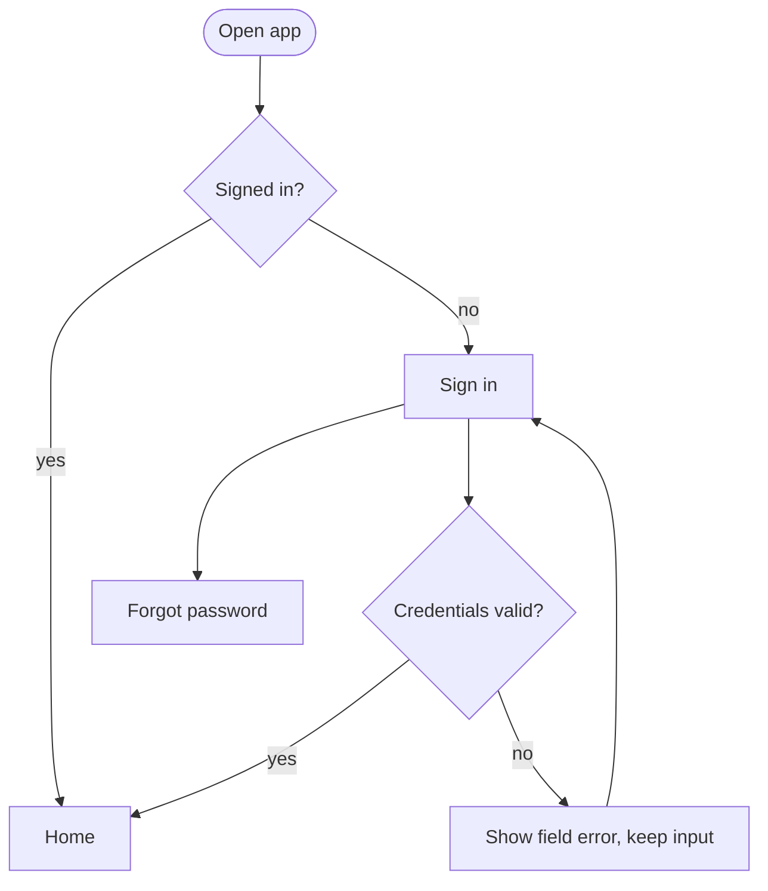
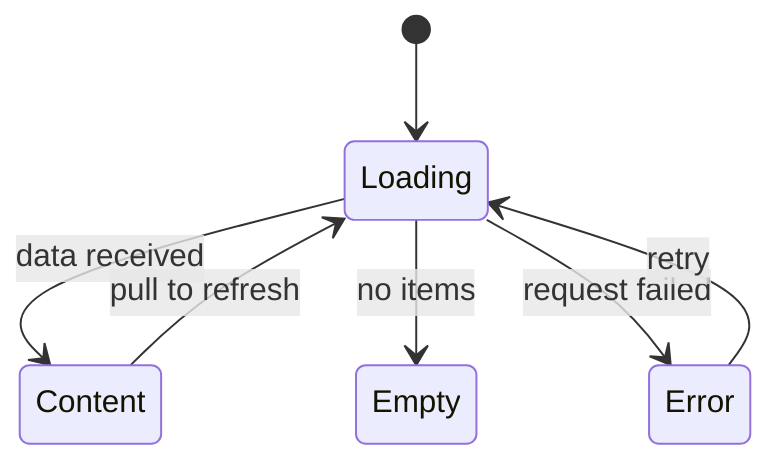
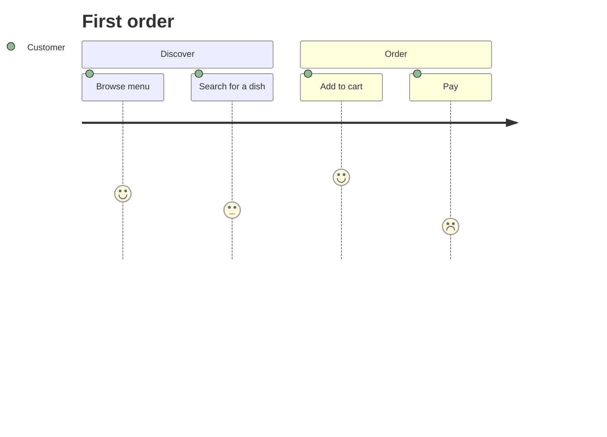

# Flows and journeys

Mermaid is plain text, so diagrams live in the repo and in a pull request. Most agent chats and GitHub render it. Use the smallest diagram that answers the question.

## Which diagram

| Question | Diagram | First line |
|---|---|---|
| What can the user do, and where does each choice lead? | Flowchart | `flowchart TD` |
| What states can one object or screen be in? | State diagram | `stateDiagram-v2` |
| How does the user feel at each step of a journey? | Journey | `journey` |
| Who calls whom (app, backend, SDK)? | Sequence diagram | `sequenceDiagram` |

A user flow is a flowchart. A "journey" in the product sense (goal, steps, pain points) is a table or a `journey` diagram; do not use it as a substitute for a flow.

## Flowchart shape

Conventions: `([ ])` for entry and exit, `{ }` for decisions with labelled edges, `[ ]` for screens, one outcome per edge. Name screens as the user sees them.

## State diagram shape

## Journey shape

The number after the step is a satisfaction score from 1 to 5 and is a judgement, not data; say so, or leave journeys out until there is research behind the scores.

## Paths people forget (check each flow against this)

- First launch versus returning user; signed in versus signed out; session expired in the middle of a flow.
- Permission asked and denied, denied permanently, or granted for "while using" only.
- No network at the start, lost during a submit, or returning after being offline (what is queued, what is lost).
- Empty list, one item, very many items; failed load of the next page.
- Back button and swipe-back from every screen, including after a successful submit (can the user go back to a finished form?).
- Deep link or notification opening a screen when the user is signed out or the item no longer exists.
- Cancel, undo and delete: confirmation, and what happens to related data.
- Roles: what a screen shows to someone who may not use it.
- Update required or service unavailable.
- Account deletion and sign out (store review expects an in-app way to delete an account if the app lets people create one; check the current store rule before relying on this, it is not verified here).

## Extra paths when data syncs between devices (check when the plan has sign-in plus cloud data)

- First sign-in on a device that already has local data: merge, ask which to keep, or upload? Decide and draw it.
- Same account on two devices changing the same item offline: which edit wins, and does the user see a conflict?
- Sign out: is local data kept, cleared or kept but hidden? Signing in as a different user must never show the previous user's data.
- Offline changes waiting to upload when the session expires or the app is killed; retry rules; what the user sees while pending.
- Account deletion: cloud data, local data and anything shared with other users.
- Existing users updating to the version with sync: how their local-only data migrates (a one-time import slice), and what happens if they never sign in.
- Where the local data lives today (a single preferences blob, files, a database): moving to per-item records with change tracking is often the first slice, not an afterthought.

## Rules

- One flow per diagram; link flows with a named exit ("goes to: Checkout").
- Every decision has every outcome drawn. A diagram with only happy edges is not a flow.
- If the screens are not designed yet, flows use working names; mark them as such.
- Validate syntax by rendering when a tool is available (`mmdc -i file.mmd -o file.svg`); a diagram that does not render is not delivered.
